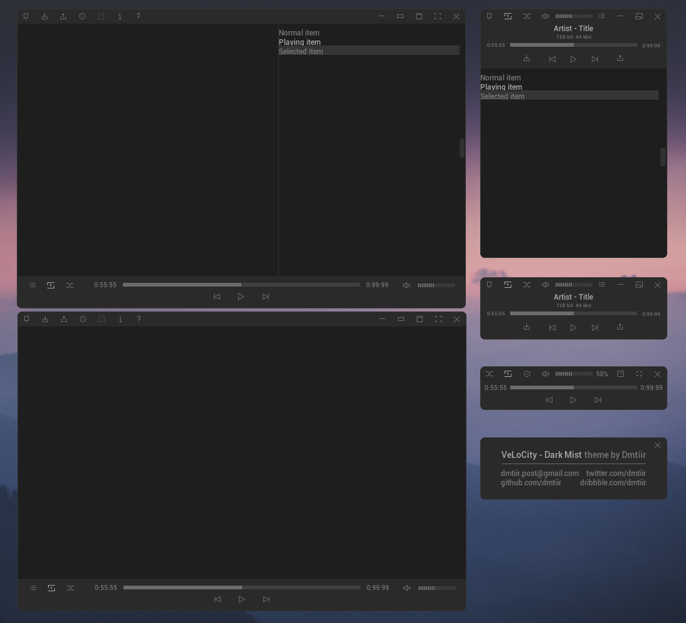
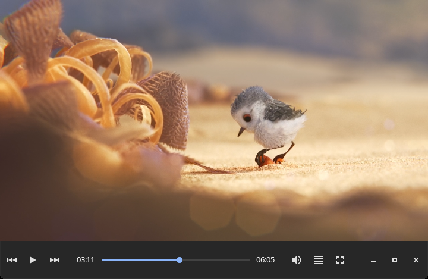

# VLC Skins

VLC skins and VLC look-and-feel experiments, including **VLC Redesign**, a standalone player built on VLC's engine from Juxtopposed's redesign.

## VLC Redesign (player)

A Windows media player that brings [Juxtopposed's VLC redesign](https://youtu.be/ERFeOgqk324) to life on top of your installed VLC. It uses VLC's engine, your VLC settings and your hotkeys, with auto-hiding bars, a fullscreen floating controller, a music view with a waveform seek bar, dark menus, a settings sidebar, a queue, and Explorer *Open with* integration.

**[Download](https://github.com/Sayandeep1013/vlc-skins/releases/latest)** · [Details, build and credits](vlc-redesign/README.md)


The earlier VLC Redesign *skin* (`vlc-redesign/dist/VLC-Redesign.vlt`) is still included; see the [project README](vlc-redesign/README.md#the-skin-earlier-version).

## Included Skins

### VeLoCity Dark Mist

Source project: `VeLoCity-Skin-for-VLC`

Tested skin file:

```text
VeLoCity-Skin-for-VLC/extracted-dark-mist/VeLoCity - Dark Mist/VeLoCity-Dark-Mist.vlt
```

Installed test copy:

```text
D:\vlc\skins\VeLoCity-Dark-Mist.vlt
```

### Materia

Source project: `materia-vlc`

Packaged skin file:

```text
materia-vlc/dist/Materia.vlt
```

Installed test copy:

```text
D:\vlc\skins\Materia.vlt
```

## VLC Install

1. Copy a `.vlt` file into VLC's `skins` folder.
2. Open VLC.
3. Go to `Tools -> Preferences -> Interface`.
4. Select `Use custom skin`.
5. Choose the `.vlt` file.
6. Save and restart VLC.

## Previews

Official preview images from each upstream skin project:

| VeLoCity - Dark Mist | Materia |
|---|---|
|  |  |

## Upstream Projects

- VeLoCity Skin for VLC: https://github.com/dmtiir/VeLoCity-Skin-for-VLC
- Materia VLC: https://github.com/PapirusDevelopmentTeam/materia-vlc

Respect the upstream licenses when redistributing or modifying these skins.
