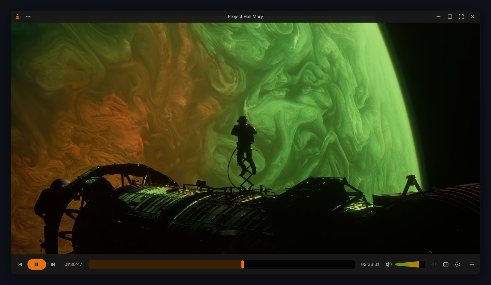
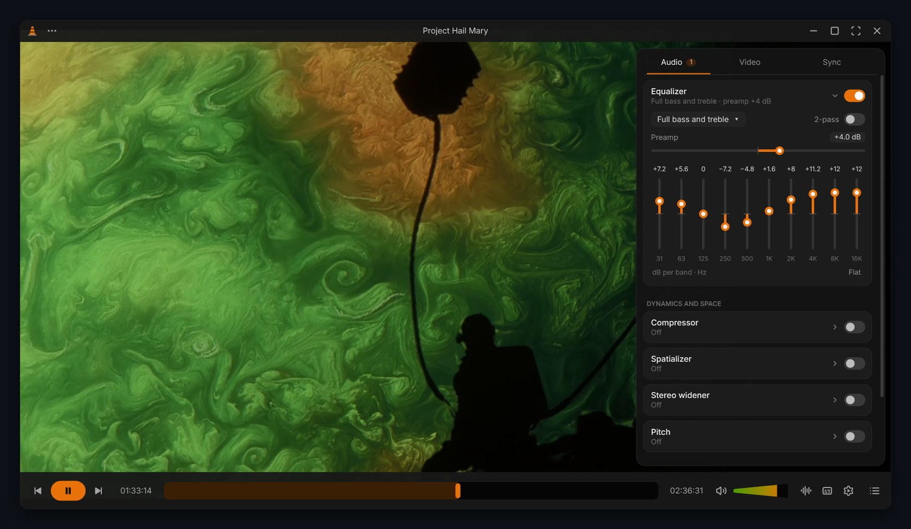
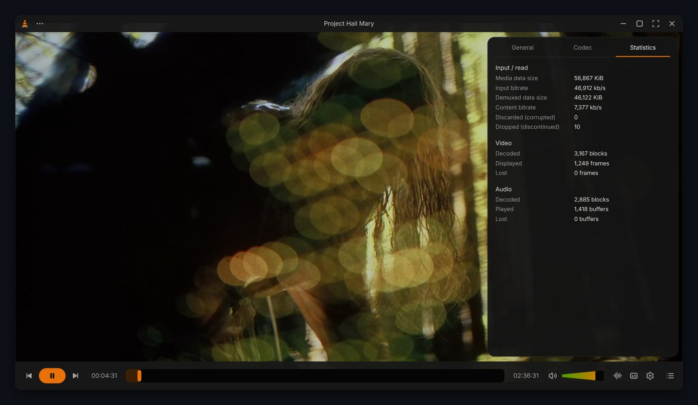
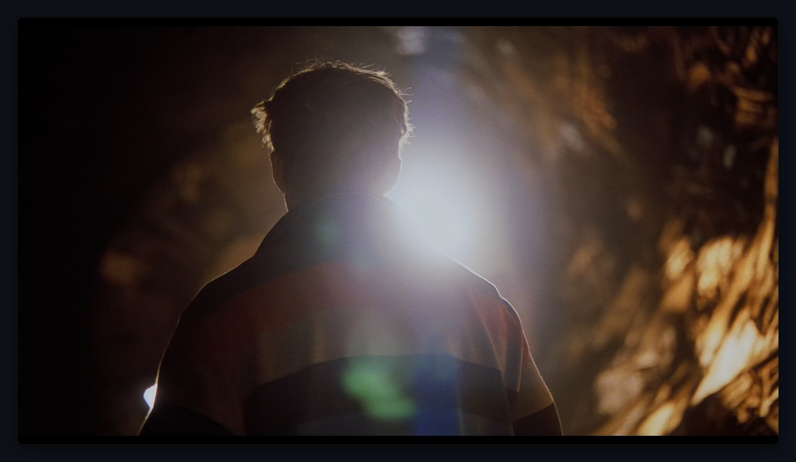

<h1 align="center">VLC Redesign</h1>

<p align="center"><b>Juxtopposed's VLC redesign, made real: a modern Windows player running on the VLC you already have.</b></p>

<p align="center">
  <a href="https://github.com/Sayandeep1013/vlc-skins/releases/latest"></a>
  <a href="https://github.com/Sayandeep1013/vlc-skins/releases"></a>
  <a href="LICENSE"></a>
  
  
</p>

<p align="center">
  <a href="https://github.com/Sayandeep1013/vlc-skins/releases/latest"><b>Download</b></a> ·
  <a href="#features">Features</a> ·
  <a href="#keyboard-shortcuts">Shortcuts</a> ·
  <a href="#faq">FAQ</a> ·
  <a href="#build-from-source">Build</a> ·
  <a href="CHANGELOG.md">Changelog</a>
</p>

<p align="center">
  
</p>

> [!NOTE]
> VLC Redesign is an independent project. It is **not affiliated with, endorsed by or made by VideoLAN**. "VLC" and the cone logo are trademarks of VideoLAN. It is also not an official release from Juxtopposed.

## Why

The designer [Juxtopposed](https://juxtopposed.com) made a [VLC redesign](https://youtu.be/ERFeOgqk324) ([Figma file](https://www.figma.com/community/file/1691465999134370980)): dark, calm, with controls that get out of the way. This project builds that design as a working player.

It isn't a skin. It's a real player built on libVLC, so it plays everything VLC plays, with the same codecs and plugins. It reads your VLC settings and keyboard shortcuts, so it behaves like your VLC, just with the redesign's look and behaviour.

## Highlights

| | |
|---|---|
|  |  |
| **Fullscreen floating controller** that fades in when you move the mouse and slowly fades out | **Seek previews**: hover or drag the seek bar to see the frame, time and chapter |
|  |  |
| **Effects and Filters**: VLC's equalizer, audio and video effects, applied live | **Media and codec information**, statistics and the engine log |
|  |  |
| **Queue** with sort, repeat, shuffle, remove and add | **Player settings**: speed, chapters, tracks, delays, aspect ratio, snapshot |
|  |  |
| **Music view** with big cover art and a waveform seek bar | **Just the picture**: the bars slide away while you watch |

*Screenshots: Project Hail Mary (2026) © Amazon MGM Studios, shown to demonstrate the player.*

## Download

> [!IMPORTANT]
> You need **[VLC 3 (64-bit)](https://www.videolan.org/vlc/)** installed. VLC Redesign uses its engine; VLC itself is not included in either download.

Get it from the **[latest release](https://github.com/Sayandeep1013/vlc-skins/releases/latest)**:

| File | Size | Which one? |
|---|---|---|
| `VLC-Redesign-<version>-win-x64.exe` | ~66 MB | **Pick this one.** Self-contained: includes the .NET runtime and runs as is. |
| `VLC-Redesign-<version>-win-x64-small.exe` | ~1.5 MB | The same app without the runtime. Only if you already have the [.NET 8 Desktop Runtime](https://dotnet.microsoft.com/download/dotnet/8.0). |

Then:

1. Put the exe somewhere permanent, for example `%LOCALAPPDATA%\Programs\VLC Redesign\`, and run it.
2. If Windows shows a SmartScreen notice, choose *More info* → *Run anyway* ([why?](#why-does-windows-show-a-smartscreen-warning)).
3. Optional: `⋯` → *Add to Explorer's Open with* so you can right-click a video or song → *Open with* → *VLC Redesign*.

A Microsoft Store version is planned ([STORE.md](STORE.md)). Store installs have no SmartScreen warning and update automatically.

## Features

### The redesign

- Dark neutral greys with VLC's orange cone, rounded window corners and an orange play/pause pill.
- **Bars that stay out of the way.** They slide in when you move the mouse and slide away after a couple of seconds. They stay up while paused or while the pointer is on them.
- **A thick seek bar with YouTube-style previews.** Hovering or dragging shows a frame from that point, with its time and chapter name.
- **Cone volume.** VLC's volume wedge becomes a full green-to-orange cone that goes up to your VLC maximum (125% by default).
- The title is always at the top. All the menus are behind a single `⋯` button and a dark right-click menu.
- Audio and subtitle pickers right on the bar, including the audio output device.
- **Player settings sidebar** with Playback, Subtitles, Audio and Video tabs: speed, chapters, subtitle and audio delay, tracks, aspect ratio, snapshot.
- **A queue** (not a "playlist") with sort, repeat, shuffle, remove and add.
- On-screen messages show the action *and* the key you pressed.
- **Music view.** Songs get big cover art, title and artist, and a waveform seek bar. The waveform can be turned off under Player settings → Playback.
- **Fullscreen** has no top bar, just a floating controller with play/pause in the center that fades in when you move the mouse and slowly fades out again.

<details>
<summary>How the seek previews work</summary>
<br>

Frames come from a hidden, silent second player. It first builds a storyboard across the whole file, coarse to fine, so previews show up within a second or two. Then it decodes the exact frame wherever you pause the pointer.

</details>

### VLC's Tools

In the `⋯` menu and the right-click menu, with the same names, ranges and defaults as VLC.

- **Effects and Filters** (<kbd>Ctrl</kbd>+<kbd>E</kbd>). Changes apply live, the way VLC's own window applies them. Effects are remembered between sessions; crop, zoom and overlays reset each session, as in VLC.
- **Media Information** (<kbd>Ctrl</kbd>+<kbd>I</kbd>): editable tags with *Save metadata*.
- **Codec Information** (<kbd>Ctrl</kbd>+<kbd>J</kbd>): every stream's codec, resolution, frame rate, channels and sample rate.
- **Statistics**: live bitrates, decoded, displayed and lost frames.
- **Messages** (<kbd>Ctrl</kbd>+<kbd>M</kbd>): the engine's log with errors / warnings / debug verbosity, *Copy* and *Clear*.
- **Plugins**: the available audio and video filters and audio outputs.
- **Preferences** (<kbd>Ctrl</kbd>+<kbd>P</kbd>): opens classic VLC's preferences, which edit the same `vlcrc` this player reads.
- Also from VLC's menus: **Jump to time** (<kbd>Ctrl</kbd>+<kbd>T</kbd>), zoom, crop, deinterlace, always on top and stereo mode.

<details>
<summary>Everything in Effects and Filters</summary>
<br>

**Audio**
- 10-band equalizer with VLC's presets, preamp and 2-pass
- Compressor
- Spatializer
- Stereo widener
- Pitch shift
- Stereo mode

**Video**
- Image adjust: brightness, contrast, hue, saturation, gamma
- Sharpen, banding removal, film grain
- Crop (ratios or exact pixels)
- Zoom and aspect ratio
- Geometry: rotate 90/180/270, flips, transpose, free-angle rotate
- Colors: invert, sepia, posterize, gradient, color extraction, color threshold
- Overlay text and logo
- Advanced: anaglyph 3D, mirror, psychedelic, waves, water, motion blur, motion detect, spatial blur, denoiser, anti-flicker
- Deinterlace and its mode

**Synchronization**
- Audio and subtitle delay

</details>

### Like your VLC

- Uses your VLC installation (`libvlc`) and your `vlcrc`: hotkeys, jump sizes, volume step, max volume, snapshot folder and other preferences. It only reads `vlcrc`, never writes it.
- The arrow keys work as in VLC: Left/Right jump, Up/Down change volume, and Shift/Alt/Ctrl + arrows jump by your configured sizes.
- Drag and drop files or folders. Dropping a subtitle file adds it to the current video.
- **Open in Classic VLC** hands the current file to the regular VLC.

### Windows integration

- **Open with**: `⋯` → *Add to Explorer's Open with* puts *VLC Redesign* in the right-click → *Open with* menu for video and audio files. It's per-user, needs no admin rights and never changes your default app. *Remove from Explorer's Open with* undoes it. From the command line: `--register-open-with` / `--unregister-open-with`.
- Double-click the video for fullscreen and drag it to move the window. Resize from any edge. Snap and maximize work as usual.

## Keyboard shortcuts

All the playback hotkeys from your VLC settings work as they do in VLC (play/pause, seeking, volume, fullscreen and so on). Press <kbd>F1</kbd> in the player to see the full list. On top of those, VLC's menu shortcuts:

| Shortcut | Action |
|---|---|
| <kbd>Ctrl</kbd>+<kbd>O</kbd> | Open file |
| <kbd>Ctrl</kbd>+<kbd>F</kbd> | Open folder |
| <kbd>Ctrl</kbd>+<kbd>N</kbd> | Open network stream |
| <kbd>Ctrl</kbd>+<kbd>L</kbd> | Queue |
| <kbd>Ctrl</kbd>+<kbd>E</kbd> | Effects and Filters |
| <kbd>Ctrl</kbd>+<kbd>Shift</kbd>+<kbd>E</kbd> | Player settings |
| <kbd>Ctrl</kbd>+<kbd>I</kbd> | Media information |
| <kbd>Ctrl</kbd>+<kbd>J</kbd> | Codec information |
| <kbd>Ctrl</kbd>+<kbd>M</kbd> | Messages |
| <kbd>Ctrl</kbd>+<kbd>P</kbd> | Preferences (classic VLC) |
| <kbd>Ctrl</kbd>+<kbd>T</kbd> | Jump to time |
| <kbd>F1</kbd> | Keyboard shortcuts |
| <kbd>←</kbd> <kbd>→</kbd> | Jump back / forward (with <kbd>Shift</kbd>, <kbd>Alt</kbd> or <kbd>Ctrl</kbd>: your configured jump sizes) |
| <kbd>↑</kbd> <kbd>↓</kbd> | Volume up / down |

## FAQ

#### Why does Windows show a SmartScreen warning?

The exe isn't code-signed yet, so Windows doesn't recognise the publisher. Choose *More info* → *Run anyway*. Free signing through SignPath Foundation is being set up ([CODE_SIGNING.md](CODE_SIGNING.md)), and a Microsoft Store version is planned ([STORE.md](STORE.md)). Releases are built from this repository's source by GitHub Actions, not on a personal machine.

#### Do I need VLC installed?

Yes, **VLC 3 (64-bit)** from [videolan.org](https://www.videolan.org/vlc/). VLC Redesign uses its engine, so it plays what your VLC plays. If VLC is missing, the player tells you and links to the download. If VLC is installed in an unusual place, set the `VLC_DIR` environment variable to the folder that contains `libvlc.dll`.

#### Is this affiliated with VideoLAN?

No. It's an independent project, not made or endorsed by VideoLAN. "VLC" and the cone are VideoLAN trademarks. It uses your installed copy of VLC and bundles no VLC binaries.

#### Does it change my VLC settings?

No. It only **reads** your `vlcrc` (hotkeys, jump sizes, volume, snapshot folder and so on) and never writes it. The one exception is if you open **Preferences** (<kbd>Ctrl</kbd>+<kbd>P</kbd>), which launches classic VLC's own preferences window.

#### Where are its settings and logs stored?

- Player state (window position, volume, waveform setting): `%APPDATA%\VLC-Redesign\player.json`
- Error log: `%TEMP%\vlc-redesign-player.log`

It collects no data and has no telemetry. See [PRIVACY.md](PRIVACY.md).

#### Something's wrong. How do I report it?

[Open an issue](https://github.com/Sayandeep1013/vlc-skins/issues/new/choose). Include your VLC Redesign, VLC and Windows versions, and if you can, the log from `%TEMP%\vlc-redesign-player.log` or *Tools → Messages* (<kbd>Ctrl</kbd>+<kbd>M</kbd>).

## Build from source

The player is a .NET 8 WPF app using [LibVLCSharp](https://code.videolan.org/videolan/LibVLCSharp), in [`player/`](player).

```sh
cd player
dotnet build -c Release
# single-file release builds
dotnet publish -c Release -r win-x64 --self-contained true  -p:PublishSingleFile=true -p:IncludeNativeLibrariesForSelfExtract=true -p:EnableCompressionInSingleFile=true -o ../build/release/sc
dotnet publish -c Release -r win-x64 --self-contained false -p:PublishSingleFile=true -o ../build/release/fd
```

Icons are generated from Lucide by `player/tools/gen-icons.mjs` (writes `Themes/Icons.xaml`), and the app icon by `player/tools/gen-assets.mjs`.

<details>
<summary>Code layout</summary>
<br>

| Path | What |
|---|---|
| `player/MainWindow.xaml(.cs)` | Window, bars, fullscreen controller, menus, sidebar, queue, music view, hotkey actions |
| `player/MainWindow.Tools.cs` | VLC's Tools: effects panel, media/codec info, messages, plugins, jump to time, video/audio menus |
| `player/Core/Player.cs` | libVLC setup and the queue |
| `player/Core/VlcConfig.cs`, `HotKeys.cs` | Finds VLC, reads `vlcrc`, matches key presses to VLC's hotkey names |
| `player/Core/Effects.cs` | The effects catalogue (VLC's module and variable names, ranges, defaults) and the engine that applies them live |
| `player/Core/VlcVars.cs` | Calls into libvlccore to set those variables on the live audio/video outputs, as VLC's own window does |
| `player/Core/Thumbnails.cs` | Seek-bar preview frames (storyboard + exact frames on demand) |
| `player/Core/Waveform.cs` | Decodes audio with libVLC into peaks for the waveform seek bar |
| `player/Core/ShellIntegration.cs` | Explorer *Open with* registration (HKCU) |
| `player/UI/Controls.cs` | Seek bar (incl. waveform and preview card), cone volume, icons |

</details>

### Releases

Releases are built from source by GitHub Actions ([`.github/workflows/vlc-redesign-release.yml`](../.github/workflows/vlc-redesign-release.yml)). Pushing a tag like `v1.1.0` builds both exes, signs them once SignPath is configured, publishes the release and produces the Store `.msix` as a build artifact. See [CHANGELOG.md](CHANGELOG.md), [CODE_SIGNING.md](CODE_SIGNING.md), [STORE.md](STORE.md) and [PRIVACY.md](PRIVACY.md).

## The skin (earlier version)

Before the player, this project was a VLC 3 skin (`dist/VLC-Redesign.vlt`, built by `src/build.mjs`, plus a small auto-hide helper in `helper/`). VLC skins can only reskin the window and wire buttons to built-in actions. They can't do hover-to-show bars, dark menus, smooth corners, the settings sidebar or the waveform, so the player replaced it. The skin still works if you want it:

```sh
npm install
npm run build        # -> dist/VLC-Redesign.vlt
```

Copy the `.vlt` into VLC's `skins` folder, then Tools → Preferences → Interface → *Use custom skin*. Screenshots are in [`screenshots/skin/`](screenshots/skin).

## Not built yet

Parts of the redesign that aren't here yet: the library/home screen, the subtitle timeline, the rebuilt preferences window and onboarding.

<details>
<summary>VLC Tools that are deliberately left out</summary>
<br>

- VLM, which is a streaming server.
- Program Guide, for TV tuners.
- Customize Interface, since this player's layout is the redesign itself.
- Audio visualizations, which the music view replaces.
- Interactive zoom, puzzle, and wall/clone. These need mouse input on the video or extra windows.
- Subtitle speed and duration factor.

</details>

## Credits and licenses

- **Design:** [Juxtopposed](https://juxtopposed.com). [VLC Redesign on Figma Community](https://www.figma.com/community/file/1691465999134370980), CC BY 4.0. This project is an independent adaptation, not an official VLC or Juxtopposed release.
- **Engine:** [VLC / libVLC](https://www.videolan.org/) (LGPL 2.1+) via [LibVLCSharp](https://code.videolan.org/videolan/LibVLCSharp) (LGPL 2.1+). Uses your installed VLC; no VLC binaries are bundled.
- **Icons:** [Lucide](https://lucide.dev), ISC.
- **Font:** [Inter](https://rsms.me/inter/), SIL OFL 1.1 ([`src/fonts/OFL.txt`](src/fonts/OFL.txt)).
- **Code in this folder:** MIT ([`LICENSE`](LICENSE)).
- "VLC" and the cone logo are trademarks of VideoLAN. This project is not affiliated with VideoLAN.
