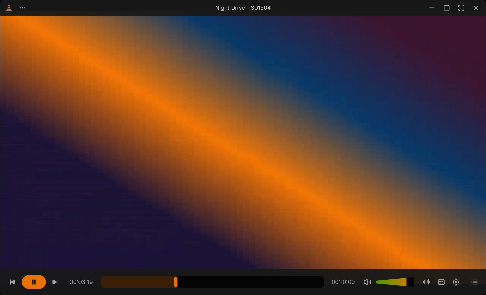
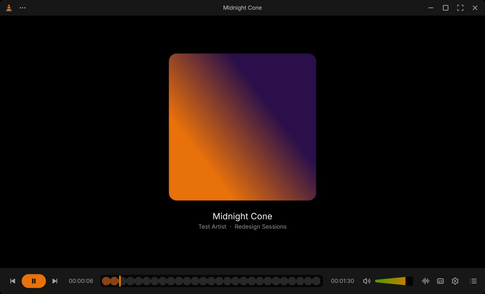
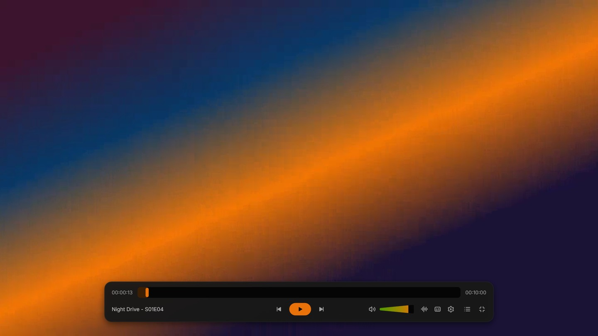
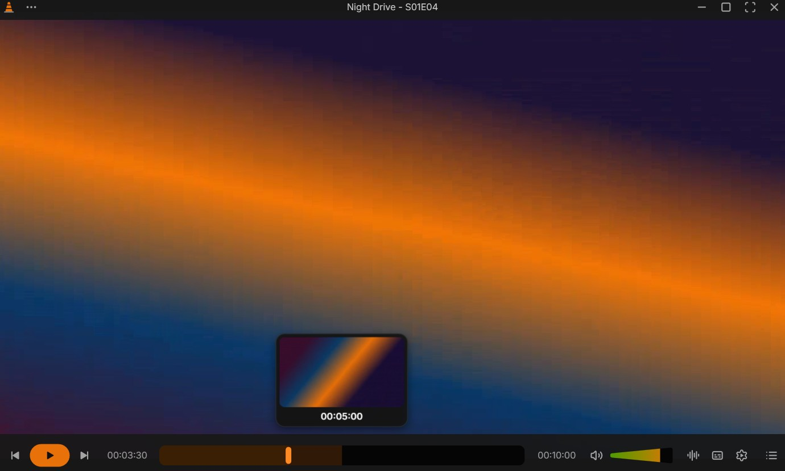
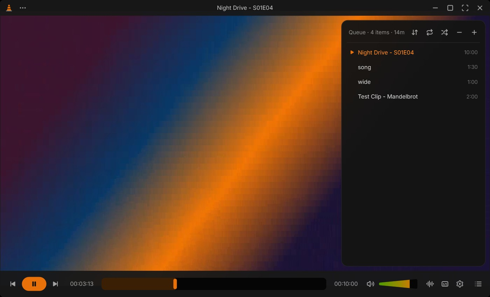
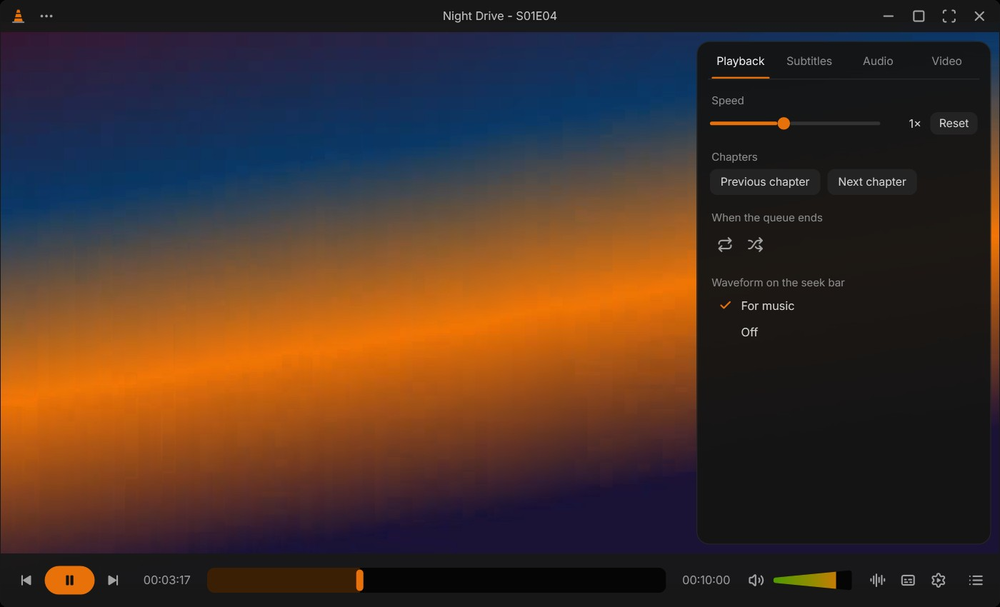

# VLC Redesign

A Windows media player that brings **[Juxtopposed's VLC redesign](https://youtu.be/ERFeOgqk324)** to life, running on the VLC engine you already have installed.

It isn't a skin. It's a real player built on libVLC, so it plays everything VLC plays, with the same codecs and plugins. It reads your VLC settings and keyboard shortcuts, so it behaves like your VLC, just with the redesign's look and behaviour.

**[Download the latest release](https://github.com/Sayandeep1013/vlc-skins/releases/latest)**



| Music: cover art and waveform seek bar | Fullscreen controller |
|---|---|
|  |  |

| Seek preview | Queue | Player settings |
|---|---|---|
|  |  |  |

## Features

**From the redesign**
- Dark neutral greys with VLC's orange cone, rounded window corners, and an orange play/pause pill.
- The bars stay out of the way. They slide in when you move the mouse and slide away after a couple of seconds. They stay up while paused or while the pointer is on them.
- A thick seek bar with YouTube-style previews. Hovering or dragging shows a frame from that point, with its time and chapter name. Frames come from a hidden, silent second player: a storyboard across the whole file first (coarse to fine, so previews show up within a second or two), then the exact frame wherever you pause the pointer. VLC's volume wedge becomes a full green-to-orange cone that goes up to your VLC maximum (125% by default).
- The title is always at the top. All the menus are behind a single `⋯` button and a dark right-click menu.
- Audio and subtitle pickers right on the bar, including the audio output device.
- A player-settings sidebar with Playback, Subtitles, Audio and Video tabs: speed, chapters, subtitle and audio delay, tracks, aspect ratio, snapshot.
- A queue (not a "playlist") with sort, repeat, shuffle, remove and add.
- On-screen messages show the action *and* the key you pressed.
- Songs look different from videos: big cover art, title and artist, and a waveform seek bar. The waveform can be turned off under Player settings → Playback.

**Fullscreen**
- No top bar. A floating controller with play/pause in the center fades in when you move the mouse and slowly fades out again.

**Like your VLC**
- Uses your VLC installation (`libvlc`) and your `vlcrc`: hotkeys, jump sizes, volume step, max volume, snapshot folder, and other preferences. It only reads `vlcrc`, never writes it.
- The arrow keys work as in VLC: Left/Right jump, Up/Down change volume, and Shift/Alt/Ctrl + arrows jump by your configured sizes.
- Menu shortcuts: <kbd>Ctrl</kbd>+<kbd>O</kbd> open, <kbd>Ctrl</kbd>+<kbd>F</kbd> folder, <kbd>Ctrl</kbd>+<kbd>N</kbd> network stream, <kbd>Ctrl</kbd>+<kbd>L</kbd> queue, <kbd>Ctrl</kbd>+<kbd>E</kbd> player settings, <kbd>F1</kbd> keyboard shortcuts.
- Drag and drop files or folders. Dropping a subtitle file adds it to the current video.
- **Open in Classic VLC** hands the current file to the regular VLC.

**Windows**
- **Open with**: `⋯` → *Add to Explorer's Open with* puts *VLC Redesign* in the right-click → Open with menu for video and audio files. It's per-user, needs no admin rights, and never changes your default app. *Remove from Explorer's Open with* undoes it.
- Double-click the video for fullscreen and drag it to move the window. Resize from any edge. Snap and maximize work as usual.

## Install

You need **VLC 3 (64-bit)** installed ([videolan.org](https://www.videolan.org/vlc/)). The player uses its engine.

Two downloads on the [releases page](https://github.com/Sayandeep1013/vlc-skins/releases/latest):

| File | Size | Notes |
|---|---|---|
| `VLC-Redesign-<version>-win-x64.exe` | ~70 MB | **Pick this one.** Self-contained: includes the .NET runtime it's written in, runs as is |
| `VLC-Redesign-<version>-win-x64-small.exe` | ~1.5 MB | The same app without the runtime. Only if you already have the [.NET 8 Desktop Runtime](https://dotnet.microsoft.com/download/dotnet/8.0) |

Neither includes VLC itself; both use the VLC installed on your PC.

Windows may show a SmartScreen notice because the exe isn't code-signed yet (*More info* → *Run anyway*). Free signing through SignPath Foundation is being set up ([CODE_SIGNING.md](CODE_SIGNING.md)), and a Microsoft Store version is planned ([STORE.md](STORE.md)). Store installs have no warning and update automatically.

Put the exe somewhere permanent, for example `%LOCALAPPDATA%\Programs\VLC Redesign\`, and run it. To add it to *Open with*, use the `⋯` menu, or run it once with `--register-open-with` (remove with `--unregister-open-with`).

If VLC is installed in an unusual place, set `VLC_DIR` to the folder that contains `libvlc.dll`.

Player state (window position, volume, waveform setting) is saved in `%APPDATA%\VLC-Redesign\player.json`. Errors are logged to `%TEMP%\vlc-redesign-player.log`.

## Releases

Releases are built from source by GitHub Actions ([`.github/workflows/vlc-redesign-release.yml`](../.github/workflows/vlc-redesign-release.yml)). Pushing a tag like `v1.0.1` builds both exes, signs them once SignPath is configured, publishes the release, and produces the Store `.msix` as a build artifact. See [CODE_SIGNING.md](CODE_SIGNING.md), [STORE.md](STORE.md) and [PRIVACY.md](PRIVACY.md).

## Build

The player is a .NET 8 WPF app using [LibVLCSharp](https://code.videolan.org/videolan/LibVLCSharp), in [`player/`](player).

```sh
cd player
dotnet build -c Release
# single-file release builds
dotnet publish -c Release -r win-x64 --self-contained true  -p:PublishSingleFile=true -p:IncludeNativeLibrariesForSelfExtract=true -p:EnableCompressionInSingleFile=true -o ../build/release/sc
dotnet publish -c Release -r win-x64 --self-contained false -p:PublishSingleFile=true -o ../build/release/fd
```

Icons are generated from Lucide by `player/tools/gen-icons.mjs` (writes `Themes/Icons.xaml`), and the app icon by `player/tools/gen-assets.mjs`.

Layout of the code:

| Path | What |
|---|---|
| `player/MainWindow.xaml(.cs)` | Window, bars, fullscreen controller, menus, sidebar, queue, music view, hotkey actions |
| `player/Core/Player.cs` | libVLC setup and the queue |
| `player/Core/VlcConfig.cs`, `HotKeys.cs` | Finds VLC, reads `vlcrc`, matches key presses to VLC's hotkey names |
| `player/Core/Thumbnails.cs` | Seek-bar preview frames (storyboard + exact frames on demand) |
| `player/Core/Waveform.cs` | Decodes audio with libVLC into peaks for the waveform seek bar |
| `player/Core/ShellIntegration.cs` | Explorer *Open with* registration (HKCU) |
| `player/UI/Controls.cs` | Seek bar (incl. waveform and preview card), cone volume, icons |

## The skin (earlier version)

Before the player, this project was a VLC 3 skin (`dist/VLC-Redesign.vlt`, built by `src/build.mjs`, plus a small auto-hide helper in `helper/`). VLC skins can only reskin the window and wire buttons to built-in actions. They can't do hover-to-show bars, dark menus, smooth corners, the settings sidebar or the waveform, so the player replaced it. The skin still works if you want it:

```sh
npm install
npm run build        # -> dist/VLC-Redesign.vlt
```

Copy the `.vlt` into VLC's `skins` folder, then Tools → Preferences → Interface → *Use custom skin*. Screenshots are in [`screenshots/skin/`](screenshots/skin).

## Not built yet

Parts of the redesign that aren't here yet: the library/home screen, the subtitle timeline, the rebuilt preferences window, and onboarding.

## Credits & licenses

- Design: [Juxtopposed](https://juxtopposed.com). [VLC Redesign on Figma Community](https://www.figma.com/community/file/1691465999134370980), CC BY 4.0. This project is an independent adaptation, not an official VLC or Juxtopposed release.
- Engine: [VLC / libVLC](https://www.videolan.org/) (LGPL 2.1+) via [LibVLCSharp](https://code.videolan.org/videolan/LibVLCSharp) (LGPL 2.1+). Uses your installed VLC; no VLC binaries are bundled.
- Icons: [Lucide](https://lucide.dev), ISC.
- Font: [Inter](https://rsms.me/inter/), SIL OFL 1.1 (`src/fonts/OFL.txt`).
- Code in this folder: MIT (see [`LICENSE`](LICENSE)).
